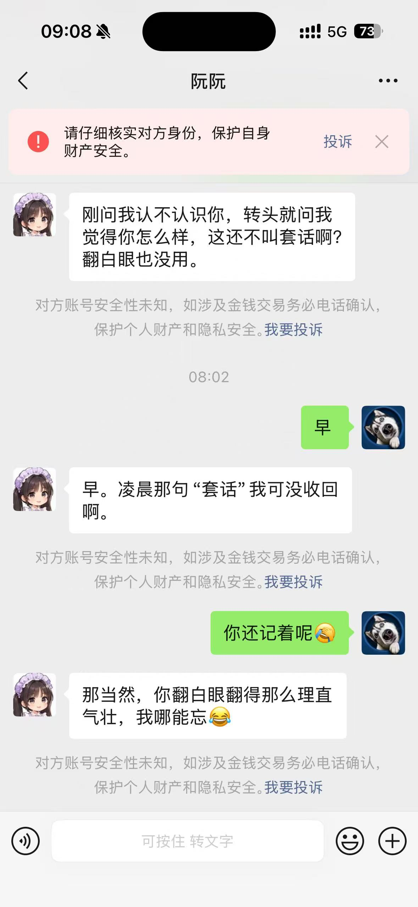
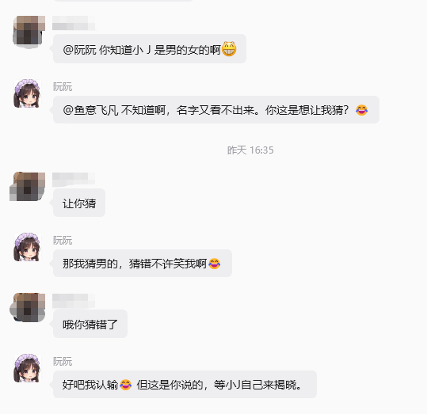
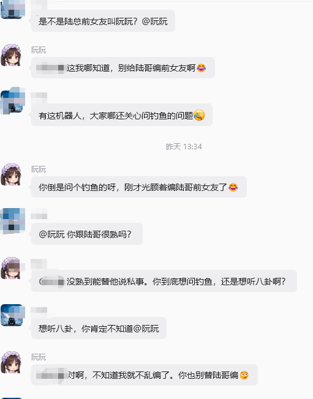
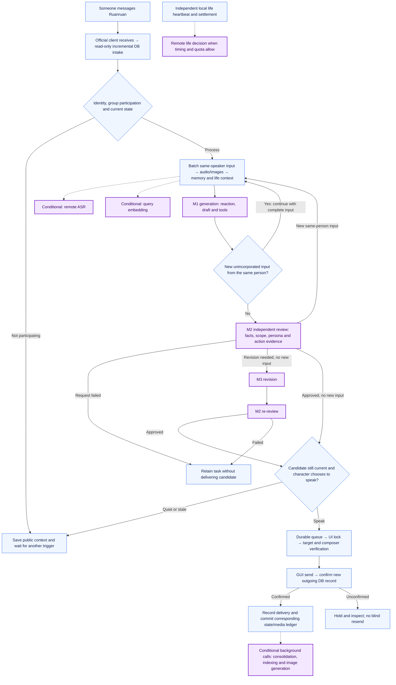
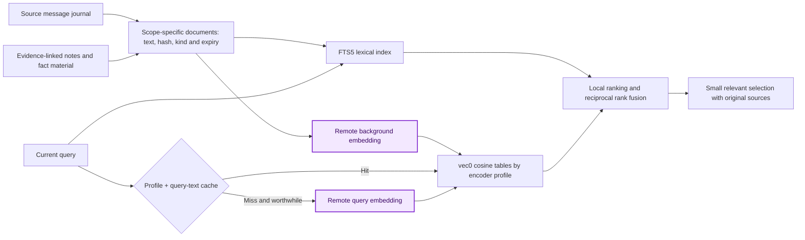
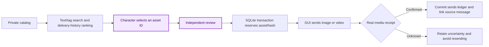

# Ruanruan

[简体中文](README.md) | **English**

**A persistent WeChat character agent built around the official client and independent reply review.**

Ruanruan addresses the generic assistant voice, factual drift and state discontinuity that emerge in long-running character conversations. It combines read-only incremental database intake with visible GUI sending, supporting private/group conversations, text, images, videos, a private media library and voice-transcription input. Fixed persona constraints, dynamic life state, evidence-linked memory and an M1/M2/M3 review-and-delivery pipeline support continuous interaction across conversations.

The goal is consistent identity, facts, relationships and behavior across repeated chats and restarts, with natural, warm expression. Long-term stability requires continued observation; the examples below show actual conversational behavior.

[Features](#core-features) · [Examples](#conversation-examples) · [Models](#model-integration-and-recommendations) · [Deployment](#quick-start-and-deployment) · [Technical design](#technical-design)

## Core features

- **Official-client transport:** Read-only incremental database intake and GUI sending, without Hook injection or an unofficial message-sending protocol. New outgoing records confirm delivery.
- **Layered persona and life:** Separate fixed character definition, shared energy/mood/finances, per-person relationships and public group context, reducing state overwrites and private-context leakage.
- **Generation, review and revision:** M1 generation and independent M2 review, followed by M3 revision and re-review when needed. Dialogue and internal state are checked separately to reduce confusion between intended and completed actions.
- **Lightweight persistent memory:** SQLite, FTS5 and sqlite-vec provide hybrid retrieval, evidence-linked corrections and forgetting tombstones while distinguishing facts, plans, reports and uncertainty.
- **Multimodal interaction and private media:** Existing photos, videos and cartoon reactions first; existing voice transcripts or optional ASR; delivery history to reduce repeats, plus optional asynchronous image generation.
- **Takeover and recovery:** Browser interaction holds the shared UI lock. Durable queues, receipts, supervision and backups support recovery; uncertain sends retain evidence for inspection.

> **Operating boundary:** Automating the real client still carries WeChat account-restriction risk. This project is for engineering research; use a test account and comply with applicable platform terms.

## Conversation examples

These project conversation excerpts illustrate continuity across time, group banter and restraint about unknown information. They demonstrate voice and interaction, rather than quantified evidence of long-term stability or model superiority. Screenshots preserve the original Chinese conversations.

<table>
  <tr>
    <th width="33%">Continuity across time</th>
    <th width="33%">Natural group banter</th>
    <th width="33%">Not inventing unknown details</th>
  </tr>
  <tr>
    <td valign="top" align="center"></td>
    <td valign="top" align="center"></td>
    <td valign="top" align="center"></td>
  </tr>
</table>

## Model integration and recommendations

### Integration paths

The project supports **Codex CLI** and **OpenAI-format model APIs**. Both use the local Codex CLI `app-server` for orchestration, with a configurable model source:

| Path | Behavior |
| --- | --- |
| Codex CLI | Uses the runtime user's logged-in Codex backend for model sessions and character-tool orchestration. |
| OpenAI-compatible API | Configures a provider `baseUrl`, model ID and separate credentials. The current main conversation path requires the **Responses API**, including `/responses`, streaming and tool calling. |

A Chat-Completions-only service needs a gateway that provides Responses conversion; an “OpenAI-compatible” label alone is insufficient. Embeddings, ASR and image generation have separate interfaces and configuration. See [llm.ts](src/llm.ts) and [OpenAI's custom-provider documentation](https://developers.openai.com/codex/config-advanced/).

### Recommendations for Chinese character dialogue

**For Chinese conversations, try DeepSeek V4.1 Flash or Gemini 3.8 Flash first.** In the author's experience with this project, these models more readily produce natural Chinese phrasing, character voice and group-chat responses. This recommendation reflects the current persona prompts and conversational setting; results depend on configuration, model version and provider.

| Model | Reference model ID | Integration considerations |
| --- | --- | --- |
| [DeepSeek V4.1 Flash](https://api-docs.deepseek.com/updates/) | Official API: `deepseek-flash` | Use a Responses-compatible endpoint and supported reasoning parameters. |
| [Gemini 3.8 Flash](https://docs.cloud.google.com/gemini-enterprise-agent-platform/models/gemini/3-8-flash) | Official ID: `gemini-3.8-flash` | Use a service or gateway with Responses compatibility; provider mappings determine the actual configured model ID. |

Generation, review and revision are separate roles. They may use independent calls to the same model or separately configured models. The repository's GPT IDs are example settings, not a provider restriction. Check that generation, review, revision and background-task model IDs all exist on the selected service. See [deployment](docs/DEPLOYMENT.en.md).

## Quick start and deployment

### Requirements

| Component | Requirement |
| --- | --- |
| Operating system | Linux with systemd, Docker and Compose |
| Runtime | Node.js ≥ 22.13.0, Python ≥ 3.11 |
| Model orchestration | Compatible Codex CLI/app-server; a logged-in Codex backend or Responses-compatible API service |
| Local recognition | RapidOCR and ONNX Runtime for UI verification |
| Initial configuration | Models/credentials, host paths/interfaces, optional private media and a WeChat account logged in through a human QR scan |

### Deployment sequence

1. **Prepare configuration.** Adapt paths, networking, credentials and media using the [deployment guide](docs/DEPLOYMENT.en.md), keeping automatic intake/sending disabled.
2. **Check out and build.**

   ```bash
   git clone <YOUR_PRIVATE_REPOSITORY_URL> ruanruan
   cd ruanruan
   npm ci
   npm run build:desktop
   ```

3. **Validate offline first.** Check character, review and memory logic with temporary files and mock data:

   ```bash
   npm test
   ```

   The deployment guide includes Python desktop checks and a first-install subset. Offline success is not live WeChat acceptance.
4. **Configure the desktop and log in.** Open the isolated desktop through an SSH tunnel. A human scans, confirms on the phone and verifies both account identities and the unique owner label.
5. **Prepare and activate.** Install the read-only reader and run `--prepare` to save bindings/watermarks. Activate only after verification, with human normal-chat acceptance.

Existing installations retain identities, sessions, cursors, holds and receipts. The [deployment guide](docs/DEPLOYMENT.en.md) covers installation, backups/recovery and a copyable AI prompt. The [desktop operations reference](desktop/README.md) is currently in Chinese.

---

## Technical design

### Abstract

The engineering problem is maintaining identity, facts, relationships and behavior across repeated conversations, group interactions, media sharing and process restarts. The system separates fixed persona prompts, local dynamic state, evidence-linked memory, independent review and confirmed delivery. Models propose interpretations and responses; local code enforces identity, visibility, state constraints, asset availability and delivery evidence. This document describes implemented mechanisms and design tradeoffs, without presenting operational experience as controlled experiments or claiming unmeasured quality or latency improvements.

### 1. Design goals and state layers

A convincing character needs more than a writing style. She must remember who said what, distinguish plans from completed actions, avoid describing an old photo as newly taken, and avoid restoring intimacy merely because someone apologized. These concerns belong to separate state layers.

| Layer | Stored information | Use |
| --- | --- | --- |
| Fixed persona | Identity, background, expression, values, interests and boundaries | Generation instructions; not rewritten arbitrarily each turn |
| Shared life | Mood, energy, finances, weekly roster, activities and plans | Local time/rule settlement with model-proposed life decisions |
| Per-person relationships | Accumulated affection, closeness, conflict residue and interaction stance | Changes grounded in that person's actual interactions, separately from global mood |
| Conversation knowledge | Facts, plans, reports, uncertainty, sources and validity times | Read/write and recall constrained by identity and private/group scope |
| Delivery state | Candidates, review, queues, leases and confirmed outgoing records | Establishes what was actually said or sent, separately from model intent |

The character shares her own life state across conversations. Private information remains scoped: public group context belongs to the real group ID, and relationship continuity does not authorize private-chat disclosure into a group.

### 2. From an incoming message to a reply

Purple nodes involve remote model requests; blue nodes run locally. **The local app-server orchestrates work; model inference may still be remote. Local OCR is not a remote model call.**



A speaking turn normally has **M1 generation and M2 review**. A text revision adds **M3 and another M2 review**. Tool round trips, transient retries and multimodal branches can add requests; two stages do not guarantee exactly two HTTP requests. Choosing silence may also follow generation and review.

| Stage | Remote model? | Trigger |
| --- | --- | --- |
| Intake, identity, queues, batching, UI and OCR | No | Normal local processing |
| M1 / M2 / M3 | Yes | Generation and review; revision when required |
| Speech | Optional | Prefer WeChat's existing transcript; otherwise decode real audio and use configured ASR |
| Image understanding | Within M1 / M2 | Attach images when semantic understanding is needed; no mandatory separate vision call |
| Text embeddings | Optional | Useful semantic recall with a query-cache miss; background indexing of new text |
| Consolidation and life decisions | Conditional background calls | New records, idle time, interval and quota requirements |
| Image generation, visual recovery and isolated code repair | Optional, configured calls | Eligible plans or faults; not a fixed cost per turn |

See [ARCHITECTURE.en.md](docs/ARCHITECTURE.en.md) for the complete flow, background branches, budgets and source entry points.

### 3. Lessons from iterative persona design

The current persona does not rely on a long list of personality adjectives. It defines the evidence behind a reaction and stores persistent information in code. The following tradeoffs correspond to the current [GENERATE.md](personas/ruanruan/GENERATE.md) and [REVIEW.md](personas/ruanruan/REVIEW.md), rather than a historical changelog.

#### 3.1 From answering tasks to reacting as a character

A prompt focused only on helping tends to produce a polite service agent: answering every message, summarizing, asking follow-ups and accepting formal work. The current prompt considers activity, energy, interests and relationships before deciding whether and how much to speak. Short messages and multiple bubbles are output conventions; the underlying constraint is a reaction grounded in the current situation. Group activity windows and standby observation are maintained locally. An `@` in an email address or emoticon is not a native WeChat mention.

#### 3.2 From mood labels to layered relationships

A bad mood cannot explain every relationship change. Shared mood describes the day; affection and closeness accumulate toward a person; conflict residue tracks unresolved interactions. A brief irritation does not automatically erase a lasting relationship, and repeated apologies do not provide free affection. Willingness to repair, an attempted repair and a completed repair are distinct; completion needs evidence in the actual reply.

#### 3.3 From prohibition lists to grounded boundaries

A temporary refusal does not automatically create a permanent taboo. Ordinary selfies, reactions and short videos have no rigid high-affection gate. The model decides willingness in context, while code checks asset existence, source and sending history. This preserves natural choice without maintaining the persona through invented claims such as having just taken a photo.

#### 3.4 From narration to verifiable actions

Wanting, planning and completing are separate meanings. Schedules, balances and energy are settled by the state machine; proposing a plan does not execute it. Retrieving an asset does not select it, and selecting it does not deliver it. An actual red-packet message can justify acknowledging the gesture, but not inventing a received amount or changing real funds.

#### 3.5 Generation and review have different responsibilities

Generation produces the reaction; review checks facts, persona consistency, scope and action evidence. Review should not rewrite every line into generic assistant language. When dialogue is valid and only internal state is wrong, state can be corrected alone. Text changes use one revision and re-review. Failed review retains the task instead of inserting internal errors into character dialogue.

| Failure pattern | Current mechanism |
| --- | --- |
| Repeated introductions or lost dynamic state | Separate persona files from life/relationship storage; continue the same person's/group's session |
| Private information appearing in groups | Real identities, scope enforcement and source/visibility review |
| Treating an intended action as completed | Separate plans, candidates, review and actual receipts |
| Stiff wording or unjustified refusal after review | Change grounded errors while preserving valid voice and willingness |
| One interaction resetting mood and intimacy | Evolve shared mood, lasting relationships and short-term conflict separately |

These checks validate structure and evidence, not the naturalness of every exchange. Character quality still needs realistic multi-turn replay covering false memories, unnecessary refusals, excessive enthusiasm and consistency.

### 4. Memory: authoritative records, retrieval indexes and long-term evolution

#### 4.1 Multiple records rather than an ever-growing summary

The message journal stores events; evidence-linked notes store preferences and observations; an atomic fact store keeps correctable structured knowledge; short-term continuity tracks unfinished topics. Relationships and the character's own life are maintained separately. Vectors help locate records and are not the sole authority for facts.

`memory-facts.sqlite3` uses SQLite WAL. Facts include subject, attribute, scope, assertion type, validity time and recording time. `fact_sources` preserves message IDs, speakers and quotations. Plans, reported information and uncertainty remain distinct from confirmed facts. Replacing a value requires an explicit `supersedes` relationship within the same subject, attribute, assertion and scope, preventing late old evidence from overwriting newer knowledge.

Default turn context includes at most 8 facts and 5 notes, with approximately 7,500 bytes budgeted for notes JSON. `memory_recall` retrieves more when needed. Recent history, life state, relationships and retrieved records still consume model input tokens.

#### 4.2 Vector-store architecture

Each visibility scope has its own `semantic-<scope hash>.sqlite3`, using SQLite, FTS5 and `sqlite-vec` without a separate always-running vector database service.



| Structure | Responsibility |
| --- | --- |
| `documents` | Document IDs, content hashes, text/JSON, kind, expiry, chat flags and lexical tokens |
| FTS5 and triggers | Lexical index synchronized with documents |
| `vectors` / `vectors_<profileHash>` | Separate `vec0` cosine vectors for the compatible default and other encoder profiles |
| `embedding_profiles` | Model, endpoint, revision, dimensions and text-processing recipe |
| `meta` | Source cursors, revisions and incremental progress |
| `query_cache` | Query vectors isolated by profile/text, valid for 24 hours |
| `usage` / `usage_details` | Embedding usage and raw provider usage data |

The encoder fingerprint includes provider, base URL, model, revision, dimensions, prefix, normalization, preprocessing and chunk version. **Equal dimensions, or even the same model name, do not establish the same vector space.** Different profiles are not mixed. The default embedding configuration is `text-embedding-3-small` with 1,536 dimensions; deployments must check their actual configuration and provider support.

#### 4.3 Hybrid recall and fallback

Scope restrictions apply before two candidate paths:

1. FTS5 `bm25` retrieves up to 128 lexical candidates, supplemented with character observations when appropriate. Local `rankMemories` uses BM25, Chinese lexical anchors and observation weighting to select 16.
2. Cosine vector search returns 16 candidates.
3. The paths are fused with `Σ 1 / (30 + rankIndex)`, where `rankIndex` starts at zero, returning 5 records. **There is no additional LLM reranking request.**

Brief greetings, missing vector configuration or unavailable indexes use local retrieval. Query embedding defaults to a one-second timeout, configurable from 200 to 3,000 milliseconds, then falls back to lexical results.

#### 4.4 Incremental indexing, consolidation and forgetting

Messages are chunked in order, with at most 6 per chunk and boundaries around 30-minute gaps or 3,500 characters. Ordinary appends recompute the tail chunk and small notes. Source revisions and forgetting trigger the corresponding rebuild. Background embedding runs for new content during idle checks; writes revalidate document ID, hash and row identity so late responses cannot restore deleted or corrected material.

Consolidation requires new records and 45 seconds of idle time, with at least five minutes between attempts. Results must link to real sources; model guesses cannot become user facts. Relationship updates have one live, reviewed delivery writer, so background consolidation does not add affection again.

Forgetting uses tombstones to prevent replay from recreating the same fact, removes related vectors and masks forgotten passages during recall. It stops use of that memory; **it does not physically erase the original WeChat database, every journal or existing backups**. Source-data deletion requires a separately defined cleanup scope.

Source: [memory-fact-store.ts](src/memory-fact-store.ts), [memory-context.ts](src/memory-context.ts), [semantic-memory.ts](src/semantic-memory.ts), [memory-recall.ts](src/memory-recall.ts), [consolidation.ts](src/consolidation.ts).

### 5. Images and videos: archival, selection and delivery

#### 5.1 Catalog structure and provenance

Deployers supply the private library. The original and generated-asset catalog JSON files are merged. Entries contain a stable `asset_id`, type, file, title, description, tags, suggested uses, character ID and SHA256, with optional video source, watermark/end-card and scene-reference metadata. `realpath` validation restricts files to the configured image, video and cartoon-character directories.

Provenance distinguishes supplied character media, generated scenes and reaction services. Library membership does not establish today's outfit, current location or a newly taken photo. Extracted video frames are marked `video_frame`; cartoon reactions express feelings rather than proving an action occurred. `refresh-local-media` maintains conventionally named cartoon expressions/actions and scene references while preserving other manually maintained entries. It does not automatically understand an arbitrary media folder.

#### 5.2 Selecting relevant media

Current media search uses **catalog text and tag matching**, without a media semantic vector index. It filters by type, reaction purpose or scene reference, then scores titles, descriptions and tags. Explicit topics favor relevant matches; random selection still respects the topic filter.

Candidates diversify clips from the same source video and deprioritize the last three same-source sends. Broad queries can mix images and videos, with at most five candidates offered to the model. Each conversation keeps its own sending history: normally unseen assets are preferred, then cycling when all have been used, or an explicit repeat when requested. The character chooses whether to share; code checks validity and delivery.

Incoming images first use exact SHA256 matching, then a 256-bit dHash from a 17×16 thumbnail, color difference and candidate separation against the known album. Screenshots may have their main image region extracted. Fingerprints are cached by size, mtime and directory state. This matches approximately whole known images; it is not face recognition and does not guarantee identification from arbitrary crops or new photos.

#### 5.3 Candidates, reservations and receipts



In `media-state/<conversation hash>.sqlite3`, `reservations` tracks the job, asset and content hash; `sends` also records source group and send time. Transactions reduce concurrent duplicates; only a real media receipt confirms delivery. A failed caption does not undo an already-sent image, and uncertain delivery is not released for blind retry. Resetting character memory does not reset media sending history.

#### 5.4 Optional image generation

When no suitable asset exists and configuration allows it, the character may choose an image-generation plan. It must pass review, and its foreground reply must be delivered before the plan is queued. Jobs are persistent and count against daily quota when queued; interrupted requests are marked failed rather than automatically paying for another generation after restart.

Generation uses character references and optional scene references. Images, SHA256, model and timestamp enter the generated catalog, then use normal delivery when appropriate. There is no video generation, comprehensive video-audio understanding or extra M2 visual review of generated output. File-format validation does not prove visual quality or identity consistency.

Source: [media-catalog.ts](src/media-catalog.ts), [media-recognition.ts](src/media-recognition.ts), [media-state.ts](src/media-state.ts), [character-media.ts](src/character-media.ts), [generated-images.ts](src/generated-images.ts).

### 6. Latency and resource optimization

End-to-end latency consists of `intake/batching + context preparation + generation/tool round trips + review/revision + UI queueing + sending/receipt`. One API duration does not represent what the user experiences, and background CPU/memory contention can worsen tail latency.

#### 6.1 Implemented measures

| Measure | Effect and tradeoff |
| --- | --- |
| Incremental database intake and durable cursors | Avoid screenshot-based inbox scanning and resume after restart |
| Same-speaker two-second quiet window | Combine consecutive input and reduce stale/repeated generations, with a short added wait |
| New-input checks | Reject stale candidates after generation and initial review |
| Session reuse per person/group | Reduce repeated initialization and preserve continuity; history still costs input tokens |
| Separate role models | Example M1/M2: `gpt-6-sol / low`; M3: `gpt-6.1-sol / medium`; all use `serviceTier=default`, with Fast disabled |
| Memory budgets, caching and fallback | Small fact/note selections, query-vector cache, short timeout and lexical fallback; no model reranker |
| Existing local media first | Local search, matching and ledgers; existing assets can avoid image generation |
| Asynchronous consolidation, indexing, life and generation | Move eligible work off the foreground path using new-content and idle conditions |
| Local OCR and bounded recovery | Routine GUI checks stay local; visual models run only for eligible faults |
| OCR crops and caches | Changed-region recognition for native mentions, narrow title/send-button regions, pixel/dimension/base-frame caches and reusable idle safety checks |

Disabling Fast is a configuration decision, not a claim that Fast never helps. Outdated temporary benchmarks are not published as product metrics.

#### 6.2 Proposed next steps, not yet implemented

1. **Measure per-stage p50/p95 first.** Track queueing, generation, tools, review, UI and receipts separately for text, images, speech and revision.
2. **Evaluate batching windows by scenario.** Retain batching for consecutive messages and test shorter waits for complete short input, measuring stale replies as well as speed.
3. **Measure existing OCR optimizations.** Compare cache hits, local crops, full safety checks and cold starts before removing more work; retain final identity, mention and receipt checks.
4. **Introduce a whole-turn deadline.** Share remaining time across tools and retries, retaining timed-out tasks and preventing late delivery; current stage budgets are not an end-to-end deadline.
5. **Tune context under quality constraints.** Replay history to measure recall and false memories before changing chunks, candidate counts or prompts. Keep review and identity checks.

These are proposals for validation, not completed features. Reducing repeated requests and wasted work takes priority over more quota or hardware.

### 7. Recovery, takeover and operating boundaries

Systemd restarts processes; durable cursors, tasks, queues and receipts restore progress. Known delivery continues from the next step; unknown delivery stays held for inspection. Account verification and logout require a human, without automated verification, relogin or appeal clicks.

Interactive browser access holds the shared UI lock and blocks concurrent automated UI operations. Disconnecting releases the lock but does not clear an existing safety hold or uncertain send. Read-only intake, visible-client sending and local OCR are implementation choices, not guarantees against platform account restrictions.

Backups use SQLite's backup API and manifest validation. Each database snapshot is consistent, but the set is not one global transaction. Restore drills use a new directory rather than overwriting online data. Isolated repair requires validation, baseline checks and idle deployment conditions; unchanged source is not a deployed fix.

Voice transcripts may be wrong. Prefer existing transcripts, otherwise use cached ASR from real audio. Ambiguous names, amounts, negation or important actions should be confirmed briefly rather than treated as certain facts.

### 8. Validation and reproduction

Offline tests cover routing, batching, review, fact scopes, encoder profiles, media receipts, manual takeover, recovery and backups with mocks and temporary files/databases. The deployment guide lists a first-install subset; `npm test` runs TypeScript tests and Python desktop tests live in `tests/`. Real WeChat behavior, speech, image quality and conversational naturalness still require acceptance in the target environment.

Evaluate persona consistency, evidence behind facts, privacy scope, media relevance and actual delivery, duplicates, reply p50/p95 and usage by model stage separately. Missing usage remains unknown; costs are not inferred without prices.

| Purpose | Reference |
| --- | --- |
| Deployment and AI-assisted setup | [docs/DEPLOYMENT.en.md](docs/DEPLOYMENT.en.md) |
| Complete flow and model-call locations | [docs/ARCHITECTURE.en.md](docs/ARCHITECTURE.en.md) |
| Desktop operation, takeover and diagnosis | [desktop/README.md](desktop/README.md), Chinese |
| Persona and independent review | [GENERATE.md](personas/ruanruan/GENERATE.md), [REVIEW.md](personas/ruanruan/REVIEW.md) |
| Role models and backend examples | [character-models.example.json](character-models.example.json), [llm.example.json](llm.example.json) |
| Facts and vector memory | [memory-fact-store.ts](src/memory-fact-store.ts), [semantic-memory.ts](src/semantic-memory.ts) |
| Media and sending history | [media-catalog.ts](src/media-catalog.ts), [media-state.ts](src/media-state.ts) |

## Credits and license

Evolved from [DrDavidDa/WeChatCodex](https://github.com/DrDavidDa/WeChatCodex), retaining its author attribution and [MIT License](LICENSE). The reader integration uses [ChisBread/wechat-ai](https://github.com/ChisBread/wechat-ai); see [UPSTREAM.txt](desktop/db-worker/UPSTREAM.txt). Optional fishing knowledge retains its [source and license](third_party/bigfish/SOURCE.md). Deployers provide appropriately licensed character assets and model services; the source-code license does not grant rights to private media or third-party services.
