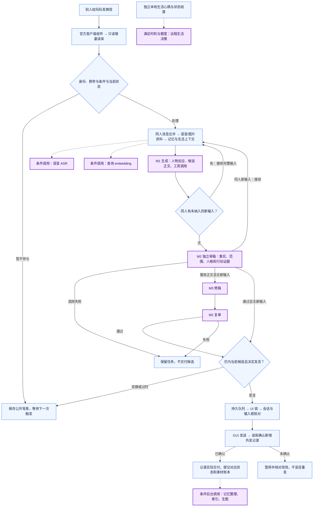
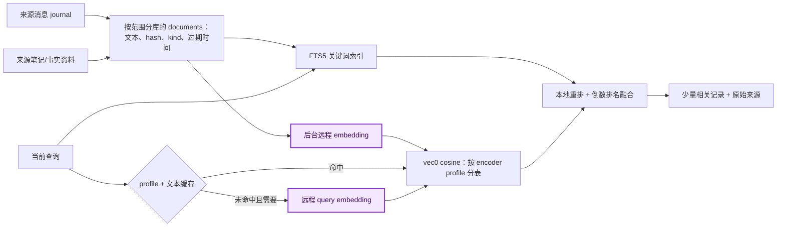
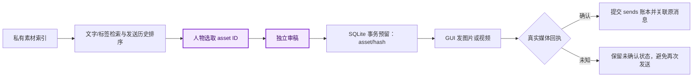

# 阮阮

**简体中文** | [English](README.en.md)

**一个有连续人格、关系记忆与生活状态的微信人物聊天系统。** 项目已实现个人微信私聊和群聊的自动收件、人物回复、独立审稿、图片与视频分享、长期记忆、生活心跳、人工接管及故障恢复。消息来自官方 Linux 微信客户端的本地数据库，发送通过可见客户端界面完成。

本仓库提供当前阮阮的源码、人物提示词、配置示例与部署说明。真实账号、聊天、凭据、私有素材及本机其他接入不随仓库发布。人格设定以双方知晓的 AI 虚构人物交流为前提，生活账本是角色模拟状态。

## 已完成什么、能做什么

| 能力 | 当前实现 |
| --- | --- |
| 微信聊天 | 私聊、原生提及与引用触发的群聊、活跃期接续、群公开背景与待机检查；可选择暂不发言 |
| 连续人格 | 固定人物背景、自然口语、按人关系与冲突余波；动态生活、情绪和体力参与反应 |
| 回复审查 | M1 生成、M2 独立审稿，必要时 M3 修稿并复审；正文和后台状态分别校验 |
| 长期记忆 | 带来源的事实、笔记、近期连续性；私聊/群聊范围隔离；更正、遗忘、混合检索 |
| 多模态 | 图片作为模型输入；语音优先已有转写、可选 ASR；本地图片/视频/表情选取、发送账本与可选异步生图 |
| 生活模拟 | 每周生成整周排班，心跳结算心情、体力、收支和计划；日志按日期展示事件及数值变化，只列管理员关系数值 |
| 人工接管 | 浏览器远程桌面；交互连接持有 UI 锁，最后一个连接退出后释放，自动流程再按当前状态运行 |
| 可靠性 | 持久队列、读库游标、发送租约、真实回执、异常暂停、进程监督、受限视觉恢复、可选隔离修复与状态备份 |

## 怎么部署

**目标环境：Linux + Docker/Compose + systemd + Node.js ≥ 22.13.0 + Python ≥ 3.11 + Codex app-server。** 模型可用已登录的 Codex 或配置的 API 供应方，OCR 使用本地 RapidOCR/ONNX Runtime。首次微信登录需要本人扫码和身份核对。

1. 阅读 [完整部署说明与 AI 部署提示词](docs/DEPLOYMENT.md)。其中包含主机检查、模型凭据、容器网络、首次登录、启用、验收、备份和恢复步骤。
2. 编译源码，适配桌面模板，保持自动收发禁用；配置人物提示词、模型与私有素材目录。
3. 启动桌面，通过 SSH 隧道打开网页，真人扫码并核对微信号、管理员和会话。
4. 在离线验证通过、身份核对完成后执行数据库准备，再启用自动收发。已有安装保留身份、游标、会话、暂停和回执，不用新安装模板覆盖运行数据。

```bash
git clone <YOUR_PRIVATE_REPOSITORY_URL> ruanruan
cd ruanruan
npm ci
npm run build:desktop
# 接着按 docs/DEPLOYMENT.md 配置与登录；编译成功不等于已启用微信。
```

希望让 AI 协助部署，可以复制下面这段，或使用部署文档中更完整的中文版：

> 请基于此仓库部署阮阮。先读取 AGENTS.md、desktop/AGENTS.md、docs/DEPLOYMENT.md，检查主机、现有服务和配置；按实际环境适配模板，保留其他项目。先编译和执行离线测试，再以禁用收发的配置安装桌面、读库和运行时。凭据只保存在本机，不写入 Git。需要微信扫码、手机确认和身份核对时交给我；核对完成后按文档 prepare、启用，真实聊天由我验收。最后给出访问地址、服务状态、备份/恢复方法和未完成项。不自行发送合成测试消息或调用真实模型采样。

部署并非零配置一键包：主机路径、网卡、UID/GID、模型供应方和素材位置需要适配。详细运行入口见 [desktop/README.md](desktop/README.md)。

---

# 技术设计：持续人格、来源化记忆与可确认的交付

## 摘要

本项目研究的工程问题是：如何让一个长期生活在微信里的虚构人物，在多次对话、多人群聊、媒体分享与程序重启之后，仍保持身份、事实、关系与行为的一致性。系统采用“固定人格提示词 + 本地动态状态 + 带来源长期记忆 + 独立审稿 + 可确认交付”的分层结构。模型负责理解、表达和候选决策，程序负责身份、范围、状态约束、素材可用性与发送证据。本文描述当前源码中的机制与设计取舍；没有把运行经验包装为对照实验，也不以未经测量的指标宣称人格效果或速度提升。

## 1. 设计目标与状态分层

“回复像一个人”不只取决于文风。连续性还要求她记得谁说过什么、知道哪些事只是计划、不会把上一张照片说成刚拍的，也不会在一次道歉之后凭空恢复亲密度。因此，系统把容易混淆的信息拆成不同层。

| 层 | 保存什么 | 如何使用 |
| --- | --- | --- |
| 固定人格 | 身份、背景、表达习惯、价值取向、兴趣与边界 | 生成提示词；不靠每次对话随意重写 |
| 共享生活 | 心情、体力、财务、周排班、活动与计划 | 本地时间与规则结算；模型提出生活决策 |
| 按人关系 | 长期好感、亲近、冲突余波、互动姿态 | 依据该人的真实互动变化，不等同全局心情 |
| 对话事实 | 事实/计划/转述/不确定信息、来源、有效时间 | 按身份与私聊/群聊范围读写和召回 |
| 交付状态 | 候选、审查、队列、租约、已确认外发记录 | 决定“是否真的说了/发了”，与模型意图分开 |

同一人物共享自己的生活状态，并不意味着不同聊天共享私密信息。群公开背景按真实群 ID 存放；与某个人的关系连续性也不授予把他的私聊内容带进群里的权限。

## 2. 从收到一条消息到回复

下面紫色节点涉及远程模型调用，蓝色节点为本地处理。**本地 app-server 是编排器，模型推理仍可发生在远端；本地 OCR 不属于远程模型调用。**



普通发言通常有 **M1 + M2 两个模型阶段**；正文修稿增加 **M3 + M2 复审**。工具往返、暂时性失败补试或多模态支线可能增加请求，不能把“两个阶段”当成固定两次 HTTP 请求。选择安静也可能已完成生成与审查。

| 位置 | 是否调用远程模型 | 触发条件 |
| --- | --- | --- |
| 读库、身份、队列、合并、UI 操作与 OCR | 否 | 本地常规流程 |
| M1 / M2 / M3 | 是 | 生成与审稿；修稿按需 |
| 语音 | 可选 | 优先微信已有转写；缺少时解码真实音频并调用已配置 ASR |
| 图片理解 | 随 M1 / M2 | 有需要理解的图片；不固定另起一次视觉请求 |
| 文本 embedding | 可选 | 查询缓存未命中且值得语义召回；后台为新文本建索引 |
| 记忆整理、生活决策 | 是，后台条件触发 | 新记录、空闲时机和间隔/额度满足 |
| 生图、视觉恢复、隔离修代码 | 是，按需且需配置 | 合格计划或故障；不在每轮固定执行 |

完整主线、后台分支、默认预算及源文件索引见 [ARCHITECTURE.md](docs/ARCHITECTURE.md)。

## 3. 人格设定多次调整后的设计思考

当前人格不依赖一大段“性格形容词”。核心是明确她依据什么作出反应，并把需要长期一致的部分交给程序保存。以下总结对应现行 [GENERATE.md](personas/ruanruan/GENERATE.md) 与 [REVIEW.md](personas/ruanruan/REVIEW.md) 的设计取舍，不是历史版本流水账。

### 3.1 从回答任务到作出人物反应

如果提示词只强调帮助用户，角色容易变成礼貌客服：每句接话、总结、追问，随时接下正式工作。当前生成提示词先看正在做什么、精力、兴趣和关系，再决定说多少、怎么说、是否保持安静。短口语与多气泡只是输出形式；真正约束是反应须有当下依据。群聊的活跃参与窗口和待机观察也由程序维护，普通邮箱里的 `@` 或表情不会自动变成原生提及。

### 3.2 从情绪标签到多层关系

“心情差”不能解释所有关系变化。共享心情是她当天的整体状态，长期好感与亲近是对某个人的积累，冲突余波则描述尚未缓解的具体互动。分层后，一次不耐烦不会自动抹掉长期关系；反复道歉也不会免费刷回好感。修复意愿、修复尝试、修复完成分开，完成需要本轮真实回复中的证据。

### 3.3 从禁止清单到有依据的边界

一次暂时拒绝不自动变成永久禁忌；普通自拍、表情或短视频也不设置僵硬的高好感门槛。模型根据场景和意愿决定分享，程序检查素材是否存在、来源是否真实、是否已经发过。这样既能保留自然反应，也避免靠虚构“刚拍好了”维持人设。

### 3.4 从模型叙述到可验证行动

“想做”“打算做”“已做到”使用不同语义。日程、余额、体力等由状态机结算；模型提出计划不代表已经执行。素材检索返回候选不代表已经选择，选择不代表已经送达。真实红包消息可以承认对方的心意，但不能据此伪造已领取金额或改变真实资金状态。

### 3.5 生成与审稿分工

生成器负责自然反应，审稿器负责事实、人物一致性、范围和行动证据。审稿不是把每句话改成标准助手腔：正文合理、只是后台状态有误时，可以仅校正后台记录。需要改正文时才进入一次修稿与复审；审查失败保存任务，不把内部报错塞进人物聊天。

| 容易失真的问题 | 当前机制 |
| --- | --- |
| 每轮重复介绍自己，动态状态丢失 | 固定人物文件与本地生活/关系存储分离；同人/同群延续会话 |
| 私聊内容串进群聊 | 真实身份和 scope 控制；审稿检查来源与可见范围 |
| 说了就当做完成了 | 计划、候选、审查、实际回执分层 |
| 审稿导致语气僵硬或无端拒绝 | 只修改有依据的问题；保留合理口语和人物意愿 |
| 情绪和亲密度被一次互动重置 | 共享心情、长期关系、短期冲突分开演化 |

这些机制能检查结构与证据，不能从程序层面证明所有对话都自然。人格质量仍需真实场景回放，观察错记、无端拒绝、过度热情和多轮自洽，而不是只看一轮漂亮回复。

## 4. 记忆系统：权威记录、检索索引与长期演化

### 4.1 长期记忆不是一份不断增长的摘要

记忆由多种记录协作：真实消息 journal 保存事件；来源化笔记保存偏好与观察；原子事实库存储可更正的结构化事实；短期连续性保存仍在进行的话题；关系与人物生活另行维护。向量库只帮助找资料，不是事实的唯一来源。

`memory-facts.sqlite3` 使用 SQLite WAL。事实包含主体、属性、scope、断言类型、有效时间与记录时间；`fact_sources` 记录消息 ID、说话人和原话。计划、转述和不确定信息与确定事实区分。替换旧值需要明确的 `supersedes` 关系，并满足同主体、属性、断言及范围约束，不能让晚到的旧消息覆盖新事实。

默认本轮上下文最多取 8 条事实、5 条笔记，笔记 JSON 有约 7500 字节预算；模型需要更多历史时再用 `memory_recall` 查询。近期上下文、生活状态、关系和检索结果仍占用模型输入，这不是“记忆免费”。

### 4.2 向量库架构

每个可见范围使用独立的 `semantic-<scope hash>.sqlite3`，配合 SQLite、FTS5 和 `sqlite-vec`，不需要另起常驻向量数据库服务。



| 表或结构 | 职责 |
| --- | --- |
| `documents` | 文档 ID、内容 hash、文本/JSON、类型、过期时间、聊天标记与词法 token |
| FTS5 与触发器 | 与文档同步的词法索引 |
| `vectors` / `vectors_<profileHash>` | 默认兼容方案与其他编码方案分别保存 `vec0` 向量，使用余弦距离 |
| `embedding_profiles` | 模型、端点、版本、维度及文本处理配方 |
| `meta` | 来源游标、修订与增量进度 |
| `query_cache` | 查询向量缓存，按 profile 与文本隔离，24 小时有效 |
| `usage` / `usage_details` | embedding 用量及供应方原始 usage |

编码配置的指纹包含 provider、base URL、模型、revision、dimensions、prefix、normalization、preprocess 与 chunkVersion。**同维度、甚至同模型名不代表同一向量空间**，因此不同 profile 不混算。默认 embedding 配置为 `text-embedding-3-small`、1536 维；实际部署应以本机配置和供应方能力为准。

### 4.3 混合召回与降级

检索先按范围限制，再运行两条候选路径：

1. FTS5 `bm25` 取最多 128 条词法候选，询问人物观察时再补充该类记录；本地 `rankMemories` 用 BM25、中文词锚与观察加权筛成 16 条。
2. 向量按余弦距离取 16 条。
3. 按 `Σ 1 / (30 + rankIndex)` 融合两路名次，`rankIndex` 从 0 开始，最终返回 5 条。这里是倒数排名融合，**没有额外 LLM 重排请求**。

简短寒暄、未配置向量或索引不可用时走本地检索。查询 embedding 默认超时 1 秒，可配置 200–3000 毫秒；失败退回词法结果，避免召回接口拖住整轮回复。

### 4.4 增量索引、整理与遗忘

聊天按顺序分块，每块最多 6 条，并以约 30 分钟间隔、3500 字阈值切分。普通追加只重算尾块和小型笔记；来源修订或遗忘状态变化才触发相应重建。后台空闲检查有新内容才请求 embedding，写回前复核文档 ID、hash 和行身份，防止旧响应把已经更正或删除的内容重新写回来。

记忆整理也不在每轮同步调用：空闲 45 秒且有新记录才考虑，两次尝试至少间隔 5 分钟。整理结果仍须绑定真实来源，不能把模型猜测升格为用户事实；关系变化保留单一的实时交付写入来源，后台整理不再次增加好感。

遗忘使用墓碑阻止旧日志重放恢复同一事实，并同步移除相应向量、遮盖历史召回片段。它表示停止使用相应记忆，**不等于物理删除微信原始数据库、全部 journal 或已有备份**。需要完整删除源数据时应另行制定数据清理范围。

源码入口：[memory-fact-store.ts](src/memory-fact-store.ts)、[memory-context.ts](src/memory-context.ts)、[semantic-memory.ts](src/semantic-memory.ts)、[memory-recall.ts](src/memory-recall.ts)、[consolidation.ts](src/consolidation.ts)。

## 5. 图片和视频：归档、选取与发送

### 5.1 归档结构与来源语义

素材库由部署者提供，`素材索引.json` 与 `生成素材索引.json` 合并读取。每项记录稳定的 `asset_id`、类型、文件、标题、描述、标签、推荐场景、角色 ID、SHA256，以及需要时的视频来源、水印/尾屏或店景参考信息。路径经 `realpath` 检查，限制在配置素材根的图片、视频、卡通形象目录。

素材来源区分私有人物素材、生成角色场景与表情服务；照片归档在相册里，不代表今天的衣服、当前位置或刚刚拍摄。视频抽帧标注 `video_frame`，卡通表情是情绪表达，不当作她真的做了该动作。`refresh-local-media` 维护约定命名的卡通表情/动作和店景参考，保留其他人工维护记录；它不是自动理解任意文件夹全部媒体的归档器。

### 5.2 如何选一张合适的图或视频

当前媒体检索是**索引文字与标签匹配**，并未建立媒体语义向量库。先按类型、表情反应或店景参考过滤，再按标题、描述、标签匹配打分。主题明确时优先贴题结果；随机选取仍保留主题限制，不随机跳到无关素材。

同一源视频的片段先分散，近 3 次同源内容降低优先级；泛查询可以混合图片与视频，最多给模型 5 个候选。每个对话维护独立发送历史：通常优先未发过的内容，全部发过才循环，或在本轮明确重发时允许重复。人物决定是否分享，程序负责候选有效性与交付核对。

收到图片时，系统先尝试 SHA256 精确匹配，再以 17×16 缩略图形成的 256 位 dHash、颜色差与候选差距比对已知相册；必要时从截图提取大图区。指纹按文件大小、mtime 与目录状态缓存。这是已知素材的近似整图识别，不是人脸识别，也不能保证任意裁剪或新照片都认出人物身份。

### 5.3 候选、预留、发送与确认



`media-state/<conversation hash>.sqlite3` 中，`reservations` 记录预留的 job、asset 和内容 hash，`sends` 另记来源组与发送时间。事务预留减少并发重复，真实媒体回执到达后才确认。图片已发而配文失败，不撤销图片的已发记录；未知发送也不释放后盲重试。清空人物记忆与清空媒体发送账本不是同一操作。

### 5.4 可选生成图片

没有合适素材且配置允许时，人物可以选择生图计划。计划须通过审稿，且前台回复实际送达后才排队。任务状态持久化，按队列任务计入每日额度；请求中断后标记失败，不因重启自动再次付费生成。

生成使用角色参考图，按需加场景参考，保存图片、SHA256、模型与时间到生成索引，合适时再走正常发送链路。目前没有视频生成、对全部视频音轨的理解，也没有生成结果的额外 M2 视觉质量审查；文件格式检查不能证明画面或身份一定正确。

源码入口：[media-catalog.ts](src/media-catalog.ts)、[media-recognition.ts](src/media-recognition.ts)、[media-state.ts](src/media-state.ts)、[character-media.ts](src/character-media.ts)、[generated-images.ts](src/generated-images.ts)。

## 6. 回复速度与资源优化

整轮时间可拆为：`读库/等待合并 + 上下文准备 + 生成/工具往返 + 审稿/必要修稿 + UI 排队 + 发送与回执`。一次 API 的耗时不能代表用户看到回复的总延迟，后台任务占用 CPU/内存也可能放大尾延迟。

### 6.1 已实现的措施

| 措施 | 作用与取舍 |
| --- | --- |
| 增量读库与持久游标 | 收件不依赖逐张截图扫描，重启接续进度 |
| 同人 2 秒静默合并 | 合并连续输入，减少过时回复和重复模型轮次；会增加小段等待 |
| 新消息检查 | 生成后、初审后识别同人新输入，阻止旧候选继续交付 |
| 同人/同群会话复用 | 减少重复初始化，保留连续性；历史输入仍有费用，不是免费上下文 |
| 分角色模型 | 示例 M1/M2 为 `gpt-6-sol / low`，M3 为 `gpt-6.1-sol / medium`；三者 `serviceTier=default`，不启用 Fast |
| 记忆上下文预算、缓存与降级 | 少量事实/笔记，查询向量缓存，短超时后词法降级；没有模型重排 |
| 本地素材优先 | 检索、相似图匹配与账本在本地；已有素材可避免一次生图请求 |
| 异步整理、索引、生活与生图 | 新增内容和空闲时机触发，将可延后的工作移出前台 |
| 本地 OCR 与受限恢复 | 常规 GUI 核对本地执行，视觉模型只在符合条件的失败分支启用 |
| OCR 裁剪与缓存 | 原生提及先识别变化区域，标题/发送按钮使用窄区；按像素、尺寸和差分底图缓存识别结果，空闲时提前安全检查并在有效期内复用 |

当前关掉 Fast 是配置选择，不声称所有任务中 Fast 都没有收益。仓库不发布已失去代表性的临时测速结果作为产品指标。

### 6.2 下一步优化方案（尚未实现的建议）

1. **先测分阶段 p50/p95。** 复用任务时间戳记录排队、生成、工具、审稿、UI 和回执耗时，区分文字、图片、语音与修稿，避免只优化最快的一段。
2. **按场景评估合并窗口。** 对连续多句保留合并，对已完整的短输入评估更短等待；同时验收过时回复率，不能只追求首字更快。
3. **用日志评估现有 OCR 优化。** 分别观察缓存命中、局部识别、完整安全检查与冷启动耗时，再确定是否还有重复工作；继续保留目标身份、原生提及和发送证据的最终核对。
4. **给整轮统一截止时间。** 现有阶段预算并不等于整轮预算；可进一步让工具与重试共享剩余时间，超时保留任务并避免晚到结果发出。
5. **以质量约束调整上下文。** 用历史回放观察召回命中与错记，再调整块长、候选数和提示词；不通过取消审稿或省略身份核对换速度。

这些是后续可验证方案，不列入已完成功能。资源优化优先降低重复请求与无效工作，再考虑更高配额或硬件。

## 7. 恢复、人工接管与运行边界

进程停止后，systemd 负责拉起，持久游标、任务、队列和回执负责续接。发送结果已知时接续后续步骤，结果未知时保持暂停并查现场；“自动恢复”不等于自动再发一遍。账号核验和掉线交给真人，程序不自行点击验证、重登或申诉。

网页交互会持有共享 UI 锁，自动发送器不能同时操作；退出后释放，但已存在的安全暂停或未知发送不会因此被清除。只读数据库收件、GUI 发送、本地 OCR 与正常客户端行为是当前实现方式，不能据此保证微信不会限制账号。

状态备份使用 SQLite backup API 和清单校验；这是各库一致快照，不是所有数据库共同的一次事务。恢复演练写入新目录，不覆盖在线数据。隔离修复候选需通过验证、基线检查与空闲部署条件，修复失败保留故障；源码未改不能宣称已部署修复。

语音转写是可能出错的输入。已有转写优先，缺失时才用真实音频 ASR，并缓存结果；姓名、金额、否定关系或关键动作有歧义时，人物应简短确认，不能把转写文字当成绝对事实。

## 8. 验证方法与复现入口

本仓库的离线测试覆盖群路由、消息合并、审稿、事实范围、向量 profile、媒体回执、手动接管、恢复和备份等机制；以 mock、临时文件和临时数据库验证分支。部署说明列出首次部署所需的离线子集；完整 TypeScript 测试入口为 `npm test`，Python 桌面测试位于 `tests/`。真实微信、语音、图片质量与人物自然度仍需在目标环境验收，离线通过不能替代现场验证。

评估时建议分别观察：人物是否自洽，事实是否有来源，隐私范围是否正确，素材是否贴题且真实送达，消息是否重复，p50/p95 回复时间，以及各模型阶段实际 usage。缺失 usage 标为未知，价格未知时不换算账单。

| 阅读目的 | 文件 |
| --- | --- |
| 部署与 AI 协助部署 | [docs/DEPLOYMENT.md](docs/DEPLOYMENT.md) |
| 全流程和模型调用位置 | [docs/ARCHITECTURE.md](docs/ARCHITECTURE.md) |
| 桌面运行、人工接管与诊断 | [desktop/README.md](desktop/README.md) |
| 人格与独立审稿 | [GENERATE.md](personas/ruanruan/GENERATE.md)、[REVIEW.md](personas/ruanruan/REVIEW.md) |
| 角色模型与后端示例 | [character-models.example.json](character-models.example.json)、[llm.example.json](llm.example.json) |
| 事实与向量记忆 | [memory-fact-store.ts](src/memory-fact-store.ts)、[semantic-memory.ts](src/semantic-memory.ts) |
| 素材与发送记录 | [media-catalog.ts](src/media-catalog.ts)、[media-state.ts](src/media-state.ts) |

## 致谢与许可

基于 [DrDavidDa/WeChatCodex](https://github.com/DrDavidDa/WeChatCodex) 演进，保留原项目作者信息与 [MIT License](LICENSE)。读库组件和钓鱼资料的来源与许可分别见 [UPSTREAM.txt](desktop/db-worker/UPSTREAM.txt)、[BigFish SOURCE.md](third_party/bigfish/SOURCE.md)。部署者自行提供有使用权的角色素材与模型服务；源码许可不授予私有素材、人物参考图或第三方服务的权利。
