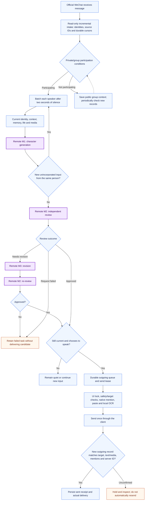
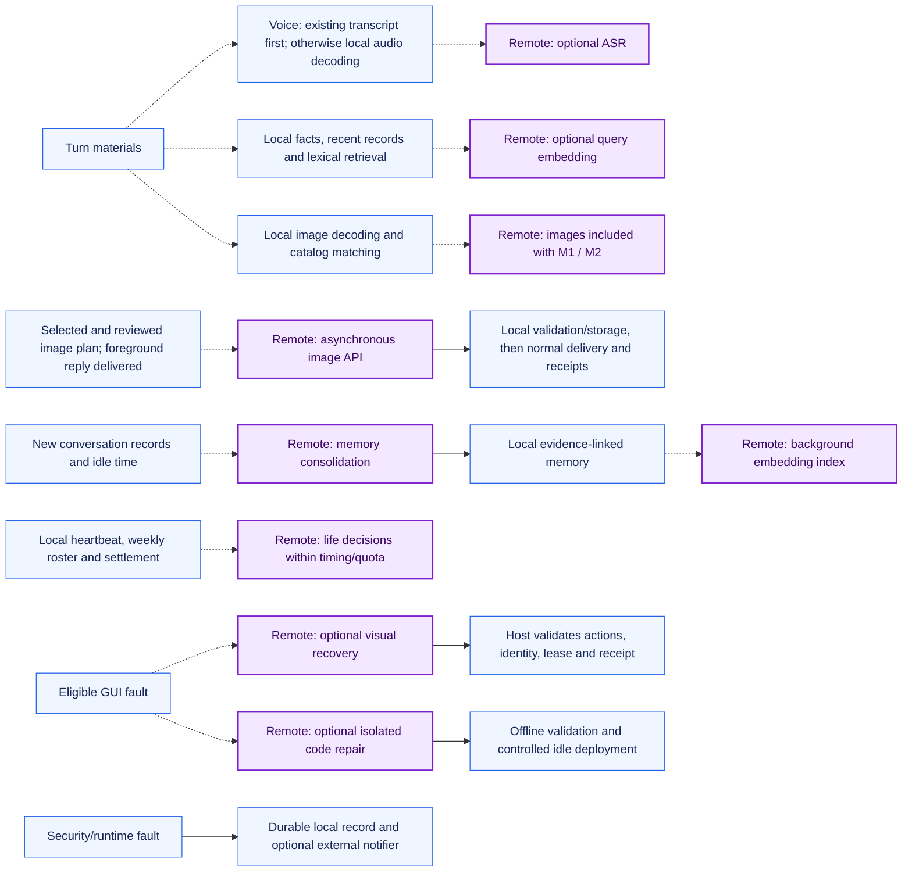

# Ruanruan architecture and message flow

[简体中文](ARCHITECTURE.md) | **English**

Ruanruan receives messages from the official Linux WeChat client's local database in read-only mode. Reviewed replies are sent through the visible client UI and confirmed against new outgoing database records. Identity, conversations, relationships, memory, life state and delivery evidence remain local. See [deployment](DEPLOYMENT.en.md) and the [project overview](../README.en.md).

## Conversation flow

**Purple nodes are remote model requests; blue nodes run locally.** Requests use a configured API provider or Codex. The local app-server orchestrates character tools; it does not make the model local. An ordinary `@`, email address or emoticon is not a native WeChat mention.

- **Intake and identity:** Source IDs distinguish actual message occurrences; deduplication does not rely on text or nicknames. Private chats are isolated by contact, public context by real group ID, and relationships by person. Route synchronization enables multiple contacts; administrator binding is not an intake allowlist.
- **Participation and batching:** Native mentions and quotes of Ruanruan can trigger immediately. Continuing participants retain a five-minute activity window; standby groups check new records every 30 minutes. The character can choose `quiet`. Consecutive text/images from one speaker use a two-second quiet window; other group members have independent timers.
- **Review:** Generation and review share the same turn materials. Normal speech uses M1 and M2; revision adds M3 and M2 re-review. New same-person input is checked after generation and initial review, preventing stale delivery. Rejected candidates and failed calls are retained without replacing character dialogue with backend errors.
- **Delivery:** Only reviewed content enters the sender. Native mentions bind actual member IDs; special-character or truncated nicknames require the real member list and composer verification. Media is confirmed before captions or mentions. Receipts establish server confirmation, not recipient reading.

## Conditional branches and background work

These branches run only when their conditions hold, rather than imposing a fixed cost on every turn.

| Stage | Trigger and current limits |
| --- | --- |
| M1 generation | A mature input batch, using role configuration. There is currently no unified whole-turn deadline; a review timeout is not an end-to-end timeout. |
| M2 review / M3 revision | Independent ephemeral sessions without execution tools; one revision and re-review. Each request has a 25-second budget; the review flow allows one transient-failure retry with a 15-second budget. |
| Speech ASR | Existing WeChat transcript first; otherwise configured ASR after local decoding. Cached by source, content and model; default request timeout 45 seconds. Ambiguous names, amounts and negation require confirmation. |
| Image understanding | Decoding and known-library matching are local. Images accompany generation/review when semantic understanding is needed; no mandatory extra vision request. |
| Media and image generation | Search configured assets first. A selected, approved generation plan is queued only after foreground delivery. Output uses normal sending; there is no additional M2 visual review of generated output. |
| Memory and embeddings | Facts, recent records and lexical retrieval are local. Query embeddings require useful old information and available configuration/indexes. Cache 24 hours; timeout defaults to one second, configurable 200–3000 ms; failure falls back locally. Consolidation needs new records and 45 seconds idle, with at least five minutes between attempts. |
| Life heartbeat | Local checks roughly every seven minutes; model decisions at least 45 minutes apart and at most 24 attempts daily. Rosters and settlement are local. Logs show events, values and changes; only administrator relationship values are listed. |
| Visual recovery | When enabled for an eligible fault, `gpt-6.1-sol / high / default`, up to four decisions per delivery/recovery, 120 seconds each. Models propose judgments and constrained coordinates; the host checks identity, text and leases. After a send click, only receipt verification continues. |
| Isolated code repair | When enabled for a fault task, an ephemeral Codex session edits an isolated copy. Default `gpt-6.1-sol / high / default`, with a 15-minute model-task limit. Validation, unchanged-baseline and idle checks gate deployment; not every fault is automatically repairable. |
| OCR, process recovery, backups and notification delivery | Local RapidOCR/ONNX Runtime, supervision, backoff, cursor recovery, receipt checks and SQLite snapshots do not call a remote model. External notification delivery is confirmed separately. |

Role examples are in [character-models.example.json](../character-models.example.json):

| Role | Model | Reasoning effort | Service tier |
| --- | --- | --- | --- |
| Generation | `gpt-6-sol` | `low` | `default` |
| Review | `gpt-6-sol` | `low` | `default` |
| Text revision | `gpt-6.1-sol` | `medium` | `default` |

Life, consolidation, ASR, embeddings, image generation and code repair have their own configuration. Do not assume every request uses the same credentials or bill. Usage comes from provider-reported tokens, cached tokens and raw usage; missing usage remains unknown and costs are not inferred without prices.

## Operating boundaries

The verified WeChat source directory is mounted read-only, and the reader container has no network. OCR runs independently without a remote OCR API. The official visible client, shared UI lock and durable lease govern sending. Browser interaction holds the same lock until the last interactive connection closes. Inspect in-flight jobs after takeover; automatic replay is not guaranteed.

Systemd and local backoff recover process faults. Cursors, queues and receipts reduce missed intake and duplicate delivery without guaranteeing unattended recovery at every interruption point. Account verification, logout and uncertain sends stay held for human inspection. Duplicate prevention does not guarantee freedom from platform account restrictions.

Backups use SQLite's backup API and manifest verification for individually consistent databases, not one transaction across every database. Restore drills write to new directories. Keep credentials, chats, private assets and backups out of the repository.

## Source entry points

| Area | Files |
| --- | --- |
| Intake, media, GUI and recovery | [database_operator.py](../desktop/database_operator.py), [rpc.py](../desktop/db-worker/rpc.py), [transport_recovery.py](../desktop/transport_recovery.py) |
| Durable transport and group participation | [store.ts](../src/desktop/store.ts), [channel.ts](../src/desktop/channel.ts), [room-context.ts](../src/desktop/room-context.ts) |
| Batching, generation and review | [message-queue.ts](../src/message-queue.ts), [main.ts](../src/main.ts), [character-review.ts](../src/character-review.ts), [character-models.ts](../src/character-models.ts) |
| Memory and media | [memory.ts](../src/memory.ts), [semantic-memory.ts](../src/semantic-memory.ts), [asr.ts](../src/media/asr.ts), [generated-images.ts](../src/generated-images.ts) |
| Background work and takeover | [consolidation.ts](../src/consolidation.ts), [life-scheduler.ts](../src/life-scheduler.ts), [manual_control.py](../desktop/manual_control.py), [selkies_manual_control.py](../desktop/selkies_manual_control.py) |
