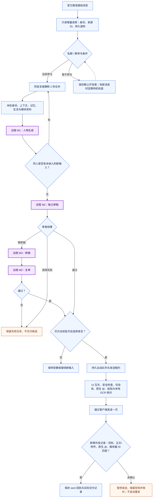
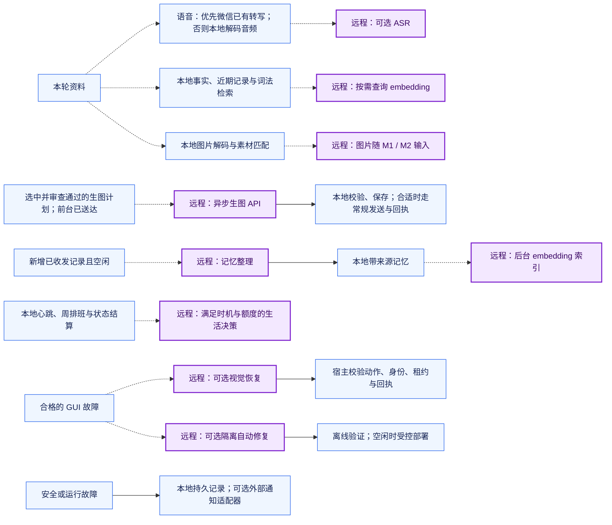

# 阮阮架构与消息流程 / Architecture

阮阮是运行在 Linux 官方个人微信客户端上的人物聊天系统：只读本地消息数据库收件，经独立审查后通过客户端 GUI 发消息。人物会话、身份、关系、记忆、生活状态和发送凭据保存在本机。部署步骤见 [DEPLOYMENT.md](DEPLOYMENT.md)，运行入口见 [desktop/README.md](../desktop/README.md)。

Ruanruan receives messages from the official Linux WeChat client's local database in read-only mode. Reviewed replies are sent through the visible client UI and confirmed against new outgoing database records. Identity, conversation, memory, life state and delivery evidence remain local.

## 对话主流程

**紫色节点为远程模型请求，蓝色节点为本地程序。** 远程请求按配置选择供应方 API 或 Codex；本地 Codex app-server 负责人物工具编排，不表示模型在本地运行。普通 `@`、邮箱和表情不等于微信原生提及。

**Purple = remote model request; blue = local processing.** Model providers and credentials are configurable. Local app-server orchestration does not make the model local.

- **收件与身份：** 来源 ID 区分每次真实消息发生，不按正文或昵称去重。私聊按联系人隔离，群公开上下文按真实群 ID 保存，关系按人物身份关联。联系人路由同步启用多用户处理；管理员身份绑定不是收件白名单。
- **群参与与合并：** 原生提及、引用阮阮可立即触发，当前参与者的接续保持 5 分钟活跃窗口；待机群每 30 分钟检查新增记录。是否发言由人物决定，可返回 `quiet`。同人连续文字、图片按 2 秒静默合并，其他群成员独立计时。
- **审查：** 生成和审稿共用本轮资料。普通发言通常调用 M1、M2；需修稿时增加 M3 和一次 M2 复审。生成后及初审后检查同人新输入，过时草稿不继续交付。审查未通过或调用失败时保存任务，不用后台错误话术代替人物回复。
- **交付：** 只有已审查内容进入发送器。原生 `@` 绑定实际成员 ID；特殊符号或截断昵称必须结合真实成员表与输入框核验。图片、视频先确认，再发随图正文或提及。回执表示服务器确认，不表示对方已读。

## 条件分支与后台任务

以下支线仅在触发条件成立时运行，不能按“每轮固定调用”计算费用。

| 阶段 | 触发与当前边界 |
| --- | --- |
| 人物生成 M1 | 需要处理的成熟批次；模型按角色配置。当前前台没有统一整轮截止时间，不能把审稿超时当成整轮超时。 |
| 审稿 M2 / 修稿 M3 | 独立临时会话，无执行工具；一次修稿后复审。每次请求预算 25 秒，整条审查流程最多一次暂时性失败补试，补试 15 秒。 |
| 语音 ASR | 已有微信转写优先；否则真实音频本地解码后调用已配置 ASR。按来源、内容及模型缓存；默认请求超时 45 秒。转写仍是可能有误的资料，重要金额、姓名、否定不清时需确认。 |
| 图片理解 | 文件解码、素材匹配在本地；需要语义理解时随生成或审查请求附图，不固定增加独立视觉调用。 |
| 本地素材与生图 | 优先查询已配置素材库。生图计划须被人物选中并经审查，前台回复实际送达后才入后台队列；输出校验后走常规投递。当前没有额外的生成结果 M2 看图复审。 |
| 记忆与 embedding | 事实/近期记录/词法检索不调用模型。需要旧资料且配置、索引可用时才查询 embedding；查询缓存 24 小时，请求超时默认 1 秒、可配置为 200–3000 毫秒，失败回退本地检索。空闲 45 秒且有新记录才考虑记忆整理，两次尝试至少间隔 5 分钟。 |
| 生活心跳 | 约每 7 分钟本地检查。模型决策至少间隔 45 分钟、每天最多 24 次尝试；排班与状态结算是本地逻辑。日志记录事件、数值与变化，关系数值只列管理员。 |
| 视觉恢复 | 配置启用且故障类型允许时，使用 `gpt-6.1-sol / high / default`，每次交付或恢复最多 4 次、每次 120 秒。模型只给判断与受限坐标；宿主仍核对身份、正文和租约，点击发送后只查回执。 |
| 隔离自动修复 | 配置启用且存在故障任务时，独立临时 Codex 会话在隔离副本修复，默认 `gpt-6.1-sol / high / default`，模型任务限时 15 分钟。候选须通过验证、基线核对和空闲部署检查；并非所有故障都能自动修复。 |
| OCR / 恢复 / 备份 / 通知投递 | RapidOCR + ONNX Runtime、本地进程监督、退避、游标恢复、回执核对和 SQLite 快照不调用远程模型。外部通知适配器是否可达由单独投递结果确认。 |

角色示例配置位于 [character-models.example.json](../character-models.example.json)：

| 角色 | model | reasoningEffort | serviceTier |
| --- | --- | --- | --- |
| generation | `gpt-6-sol` | `low` | `default` |
| review | `gpt-6-sol` | `low` | `default` |
| repair（正文修稿） | `gpt-6.1-sol` | `medium` | `default` |

后台生活、记忆、ASR、embedding、生图和自动修代码使用各自配置；不应把所有远程请求归到同一凭据或账单。用量以实际供应方返回的 token、缓存 token 和原始 usage 为准，缺失用量标记未知，没有价格时不推算费用。

## 运行边界

微信源目录只读挂载，读库容器不联网；OCR 独立运行，日常 GUI 识别没有远程 OCR API。发送使用官方可见客户端、共享 UI 锁和持久租约。网页交互接管持有同一锁，最后一个交互连接退出后释放；接管中已经在途的任务仍需查看状态，不能保证自动补发。

进程异常由 systemd 与本地退避恢复。游标、队列和回执用于避免漏读、重复交付及崩溃后盲目重发；这不保证每个中断点都能无人干预恢复。账号核验、掉线与不确定发送保持暂停，需人工核对现场。工程防重复不能量化或保证微信账号不受风控。

备份使用 SQLite backup API 生成各库一致快照并校验清单；它不是跨全部数据库同一事务。恢复演练只写新临时目录，不覆盖在线状态。人物提示词、凭据、真实聊天、素材与备份应按部署边界管理，不把私有运行数据提交到仓库。

**English:** A speaking turn normally uses generation and review; revision adds a revision call and re-review. Speech, embedding, image generation, life decisions and isolated repair are conditional remote calls. Local OCR, queues, receipts, process supervision and backups are not remote-model calls. All delivery decisions still pass host-side checks. Uncertain sends are held, not blindly replayed. Manual takeover and crash recovery have observable boundaries; neither guarantees unattended completion or freedom from platform account restrictions.

## 代码入口

| 范围 | 入口 |
| --- | --- |
| 读库、媒体、GUI 与恢复 | [database_operator.py](../desktop/database_operator.py)、[rpc.py](../desktop/db-worker/rpc.py)、[transport_recovery.py](../desktop/transport_recovery.py) |
| 持久收发与群参与 | [store.ts](../src/desktop/store.ts)、[channel.ts](../src/desktop/channel.ts)、[room-context.ts](../src/desktop/room-context.ts) |
| 合并、生成与审查 | [message-queue.ts](../src/message-queue.ts)、[main.ts](../src/main.ts)、[character-review.ts](../src/character-review.ts)、[character-models.ts](../src/character-models.ts) |
| 记忆与媒体 | [memory.ts](../src/memory.ts)、[semantic-memory.ts](../src/semantic-memory.ts)、[asr.ts](../src/media/asr.ts)、[generated-images.ts](../src/generated-images.ts) |
| 后台与人工接管 | [consolidation.ts](../src/consolidation.ts)、[life-scheduler.ts](../src/life-scheduler.ts)、[manual_control.py](../desktop/manual_control.py)、[selkies_manual_control.py](../desktop/selkies_manual_control.py) |
